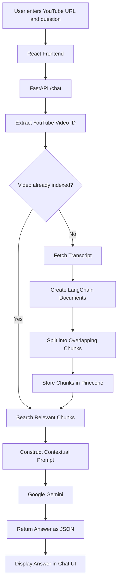

<!-- # 🎥 YouTube Assistant

> An AI-powered RAG chatbot that lets users ask questions about YouTube videos and receive answers grounded in the video's transcript.

## 🚀 Overview

**YouTube Assistant** is a full-stack Generative AI application built using **Retrieval-Augmented Generation (RAG)**.

Users provide a YouTube URL and ask questions about the video. The application automatically extracts the transcript, splits it into chunks, stores the data in **Pinecone**, retrieves the most relevant context for each question, and uses **Google Gemini** to generate a grounded answer.

If the requested information is not available in the video context, the assistant avoids making up an answer.

## 🔄 How It Works

```text
YouTube URL + Question
        ↓
   Extract Video ID
        ↓
   Check Pinecone
        ↓
 ┌──────┴──────┐
 │             │
Exists       New Video
 │             │
 │       Fetch Transcript
 │             ↓
 │          Chunking
 │             ↓
 │          Pinecone
 │             │
 └──────┬──────┘
        ↓
 Semantic Retrieval
        ↓
 Relevant Transcript Chunks
        ↓
      Gemini LLM
        ↓
   Grounded Answer


🛠️ Tech Stack

Frontend

React
Vite
Tailwind CSS

Backend

Python
FastAPI
Uvicorn

AI / RAG

LangChain
Google Gemini
Pinecone
YouTube Transcript API

Deployment

Docker
Docker Compose
Render
✨ Features
🎬 Ask questions about YouTube videos
🔗 Accept YouTube URLs directly
📝 Automatic transcript extraction
✂️ Transcript chunking with overlapping chunks
🔎 Semantic search using Pinecone
🧠 Gemini-powered contextual answers
♻️ Avoids re-processing already indexed videos
📌 Video-specific retrieval using video_id
💬 Conversational chat interface
🛡️ Context-grounded responses
🚫 Handles questions outside the video's context
📱 Responsive frontend
🐳 Dockerized application
☁️ Cloud deployment ready
🧠 RAG Pipeline
YouTube URL
    ↓
Video ID Extraction
    ↓
Transcript Extraction
    ↓
LangChain Documents
    ↓
Recursive Text Splitting
    ↓
Embeddings
    ↓
Pinecone Vector Database
    ↓
Similarity Search
    ↓
Relevant Context
    ↓
Prompt Construction
    ↓
Google Gemini
    ↓
Final Answer
🏗️ Project Structure
YouTube_Assistant/
│
├── backend/
│   ├── app/
│   │   ├── api/
│   │   │   └── routes/
│   │   │       ├── chat.py
│   │   │       └── video.py
│   │   │
│   │   ├── services/
│   │   │   ├── transcript_service.py
│   │   │   ├── chunking_service.py
│   │   │   ├── pinecone_service.py
│   │   │   ├── retrieval_service.py
│   │   │   ├── rag_service.py
│   │   │   └── video_service.py
│   │   │
│   │   ├── testing/
│   │   └── main.py
│   │
│   ├── requirements.txt
│   ├── Dockerfile
│   └── .env
│
├── frontend/
│   ├── src/
│   ├── package.json
│   └── Dockerfile
│
├── docker-compose.yml
└── README.md
⚙️ Local Setup
1. Clone the repository
git clone <YOUR_GITHUB_REPOSITORY_URL>
cd YouTube_Assistant
2. Backend
cd backend


python -m venv .venv

Activate the virtual environment.

Windows:

.venv\Scripts\activate

Install dependencies:

pip install -r requirements.txt

Create a .env file inside backend/:

GOOGLE_API_KEY=your_google_api_key
PINECONE_API_KEY=your_pinecone_api_key
PINECONE_INDEX_NAME=your_pinecone_index_name

Start the backend:

uvicorn app.main:app --reload

Backend:

http://localhost:8000

API documentation:

http://localhost:8000/docs
3. Frontend

Open another terminal:

cd frontend
npm install
npm run dev

Frontend:

http://localhost:5173
🐳 Run with Docker

From the project root:

docker compose up --build

Docker Compose starts the application services together.

🔐 Environment Variables

Create the required environment variables locally:

GOOGLE_API_KEY=
PINECONE_API_KEY=
PINECONE_INDEX_NAME=

Never commit API keys or .env files to GitHub.

💡 Example

User asks:

What does the speaker say about following others?

The system retrieves the relevant transcript chunks and Gemini generates an answer based on that context.

If the user asks something unrelated, such as:

Who is Virat Kohli?

and the information isn't present in the video transcript, the assistant responds that it could not find the answer in the provided video context instead of using unrelated knowledge.

📌 Important

The application depends on an available YouTube transcript. Videos without a usable transcript cannot be processed.

🎯 What This Project Demonstrates

This project demonstrates an end-to-end Generative AI application combining:

React
  +
FastAPI
  +
LangChain
  +
RAG
  +
Embeddings
  +
Pinecone
  +
Gemini
  +
Docker
  +
Cloud Deployment

It showcases how unstructured YouTube video content can be transformed into a searchable and conversational knowledge source.

👨‍💻 Author

Aman Dwivedi

AI/ML Engineer | Generative AI & Agentic Systems | Backend & Full-Stack Engineering -->


# 🎥 YouTube Assistant — AI-Powered Video Chat

**Chat with YouTube videos using Retrieval-Augmented Generation (RAG).**

YouTube Assistant is a full-stack Generative AI application that lets users ask questions about a YouTube video and receive answers grounded in its transcript. It automatically extracts the transcript, splits it into manageable chunks, stores them in Pinecone, retrieves relevant context for each question, and uses Google Gemini to generate context-aware responses.

Built with **React, FastAPI, LangChain, Pinecone, Google Gemini, and Docker**, the project demonstrates an end-to-end RAG pipeline, backend API development, vector search, and cloud deployment.

## 🚀 Live Demo

| Resource | Link |
|---|---|
| **Live Application** | [Open YouTube Assistant](https://youtube-assistant-ak2a.onrender.com) |
| **Backend API** | [FastAPI Backend](https://youtube-assistant-backend.onrender.com) |
| **API Documentation** | [Swagger UI](https://youtube-assistant-backend.onrender.com/docs) |
| **Source Code** | [GitHub Repository](https://github.com/AmanDwivedi2324/YouTube_Assistant) |

Try the live application by entering a YouTube URL and asking a question about the video.

> **Demo notice:** This is a personal project developed using free-tier services. Transcript availability and automated extraction depend on YouTube's access policies, rate limits, and the availability of captions. Processing new videos may occasionally fail. For the most reliable experience, use the pre-processed demo videos available in the application, where provided.

## ✨ Key Features

- **YouTube video chat:** Ask questions about a video's content using its URL.
- **Automatic transcript ingestion:** Extract available transcripts when a video has not already been processed.
- **Text chunking:** Split transcripts into overlapping chunks for context-aware retrieval.
- **Vector database integration:** Store and search transcript content using Pinecone.
- **Semantic retrieval:** Retrieve relevant transcript chunks for each question.
- **Gemini-powered responses:** Generate answers using the retrieved video context.
- **Video-specific search:** Filter retrieval by video ID to keep answers relevant to the selected video.
- **Duplicate processing prevention:** Check whether a video is already indexed before attempting ingestion.
- **Context-grounded answers:** Instruct the LLM to acknowledge when the requested information cannot be found in the supplied context.
- **Conversational interface:** Interact with the assistant through a React-based chat UI.
- **Containerization:** Run the frontend and backend together using Docker Compose.
- **Cloud deployment:** Access the deployed frontend and backend online.

## 🛠️ Tech Stack

| Layer | Technologies |
|---|---|
| Frontend | React, Vite, Tailwind CSS, JavaScript |
| Backend | Python, FastAPI, Uvicorn |
| LLM integration | Google Gemini, LangChain |
| Transcript processing | YouTube Transcript API |
| Retrieval and storage | Pinecone, semantic search, transcript chunking |
| API communication | REST, JSON, CORS |
| Containerization | Docker, Docker Compose |
| Deployment | Render |

## 🧠 System Architecture



### How the RAG pipeline works

**1. Accept the video URL**

The user submits a YouTube URL and a question through the React frontend.

**2. Extract the video ID**

The backend extracts the video ID from supported YouTube URL formats.

**3. Check Pinecone**

The application checks whether the video's transcript chunks have already been indexed. Existing videos can proceed directly to retrieval.

**4. Ingest new videos**

If the video is not indexed, the backend attempts to fetch its available transcript. The transcript is represented as LangChain documents and split into overlapping chunks.

**5. Store the transcript**

The chunks are uploaded to Pinecone with identifying metadata, including the video ID and source. This allows retrieval to be restricted to the selected video.

**6. Retrieve relevant context**

Pinecone performs a semantic search for transcript chunks relevant to the user's question.

**7. Generate a grounded answer**

The retrieved text is passed to Google Gemini through a contextual prompt. The model is instructed to answer using the supplied video context rather than inventing unsupported information.

**8. Return the response**

FastAPI returns the generated answer to the frontend, where it appears in the conversation.

## 🏗️ Project Structure

```text
YouTube_Assistant/
│
├── backend/
│   ├── app/
│   │   ├── api/
│   │   │   └── routes/
│   │   │       ├── chat.py
│   │   │       └── video.py
│   │   │
│   │   ├── services/
│   │   │   ├── transcript_service.py
│   │   │   ├── chunking_service.py
│   │   │   ├── pinecone_service.py
│   │   │   ├── retrieval_service.py
│   │   │   ├── rag_service.py
│   │   │   └── video_service.py
│   │   │
│   │   ├── testing/
│   │   └── main.py
│   │
│   ├── requirements.txt
│   └── Dockerfile
│
├── frontend/
│   ├── src/
│   ├── public/
│   ├── package.json
│   └── Dockerfile
│
├── docker-compose.yml
├── .gitignore
└── README.md
```

### Backend responsibilities

| Module | Responsibility |
|---|---|
| `main.py` | Initialize FastAPI, configure CORS, and register routers |
| `api/routes/chat.py` | Accept chat requests and coordinate video checking, ingestion, and question answering |
| `api/routes/video.py` | Expose the video ingestion endpoint |
| `transcript_service.py` | Fetch the transcript and convert it into documents |
| `chunking_service.py` | Split documents into overlapping text chunks |
| `pinecone_service.py` | Upload transcript chunks and check whether a video is indexed |
| `retrieval_service.py` | Search Pinecone for relevant chunks |
| `rag_service.py` | Build the contextual question-answering flow and call the LLM |
| `video_service.py` | Coordinate video ID extraction, transcript ingestion, chunking, and indexing |
| `testing/` | Run focused tests for individual services and pipeline stages |

## ⚙️ Getting Started

### Prerequisites

Install the following before running the application locally:

- Python 3.11 or a compatible version supported by the backend dependencies
- Node.js and npm
- Docker Desktop, if using Docker
- A Google Gemini API key
- A Pinecone API key and an appropriately configured Pinecone index

### 1. Clone the repository

```bash
git clone https://github.com/AmanDwivedi2324/YouTube_Assistant.git
cd YouTube_Assistant
```

### 2. Configure the backend

Create and activate a virtual environment:

```bash
cd backend
python -m venv .venv
```

On Windows PowerShell:

```powershell
.venv\Scripts\Activate.ps1
```

Install the dependencies:

```bash
pip install -r requirements.txt
```

Create a `.env` file inside `backend/`:

```env
GOOGLE_API_KEY=your_google_api_key
PINECONE_API_KEY=your_pinecone_api_key
PINECONE_INDEX_NAME=your_pinecone_index_name
```

Replace the placeholder values with your own credentials and index name.

Start the backend:

```bash
uvicorn app.main:app --reload
```

The backend will be available at:

- API root: `http://localhost:8000/`
- Swagger documentation: `http://localhost:8000/docs`

### 3. Configure the frontend

Open a second terminal from the repository root:

```bash
cd frontend
npm install
```

Create `frontend/.env` with the local backend URL:

```env
VITE_API_URL=http://localhost:8000
```

Start the Vite development server:

```bash
npm run dev
```

Open:

`http://localhost:5173`

Ensure the frontend API client uses `import.meta.env.VITE_API_URL` when constructing requests to the backend.

For production, configure `VITE_API_URL` to point to the deployed backend URL and rebuild the frontend.

## 🐳 Run with Docker

Make sure Docker Desktop is running. From the repository root, execute:

```bash
docker compose up --build
```

With the repository's configured port mappings, the application is available at:

| Service | Local URL |
|---|---|
| React frontend | `http://localhost:3000` |
| FastAPI backend | `http://localhost:8000` |
| Swagger documentation | `http://localhost:8000/docs` |

Docker Compose builds and starts the frontend and backend containers together.

To stop the containers:

```bash
docker compose down
```

**Note:** Configure the required environment variables and ensure the frontend is built with the correct backend API URL before running the containers.

## 🔌 API Endpoints

| Method | Endpoint | Purpose |
|---|---|---|
| `GET` | `/` | API status and basic information, if configured |
| `GET` | `/docs` | Interactive Swagger documentation |
| `POST` | `/chat` | Process a question against a YouTube video |
| `POST` | `/videos` | Ingest and index a YouTube video |

### Example: Chat request

**Endpoint**

```http
POST /chat
Content-Type: application/json
```

**Request body**

```json
{
  "youtube_url": "https://www.youtube.com/watch?v=VIDEO_ID",
  "question": "Summarize this video"
}
```

**Response format**

```json
{
  "video_id": "VIDEO_ID",
  "question": "Summarize this video",
  "answer": "A summary grounded in the retrieved video transcript."
}
```

The example answer is illustrative; actual responses depend on the video's transcript and the retrieved context.

For the complete request and response schemas, use the deployed [Swagger documentation](https://youtube-assistant-backend.onrender.com/docs).

## 🧪 Testing

The backend includes a `testing/` directory for focused development and debugging.

The service-level tests are intended to help verify individual stages, including:

- Transcript extraction
- Transcript chunking
- Pinecone indexing and search
- Retrieval results
- LLM invocation
- End-to-end RAG responses
- Video ingestion and duplicate checks

Run a test module from the `backend/` directory using the Python module syntax, for example:

```bash
python -m app.testing.test_rag
```

Use the exact module names present in `backend/app/testing/`. Tests that call Gemini, Pinecone, or the YouTube transcript service may require valid credentials and network access.

## ⚠️ Limitations

- **Transcript dependency:** The application requires an accessible transcript or captions. Videos without an available, supported transcript cannot be processed through the current ingestion pipeline.
- **YouTube access and rate limits:** Transcript extraction may fail temporarily because of rate limits, automated-access restrictions, or other YouTube-side limitations. A failure does not necessarily mean the video itself is unavailable.
- **Language and captions:** Transcript availability depends on the video's available captions and what the transcript service can retrieve.
- **LLM grounding:** Answers depend on the quality and relevance of retrieved transcript chunks. The application instructs Gemini to acknowledge when the requested information cannot be found in the provided context, but this does not guarantee that every answer is error-free.
- **Free-tier services:** The deployed demo depends on third-party free-tier availability, quotas, and service limits. Initial requests may take longer when hosted services are waking up.
- **No guarantee of arbitrary-video ingestion:** The application is designed to attempt ingestion automatically, but successful processing of every YouTube URL is not guaranteed.

For the best evaluation experience, try the pre-processed demo videos offered by the frontend when available.

## 🔐 Security and Configuration

- Never commit `.env` files, API keys, or other secrets to GitHub.
- Keep Google Gemini and Pinecone credentials on the backend.
- The frontend's `VITE_` environment variables are included in the client build and must never contain secrets.
- Configure backend CORS to allow the required local and production frontend origins.
- Use your own API credentials when running the project locally.

## 🎯 What This Project Demonstrates

YouTube Assistant demonstrates the practical implementation of:

- Retrieval-Augmented Generation (RAG)
- Transcript ingestion and document preprocessing
- Overlapping text chunking
- Vector database integration and semantic retrieval
- Context-aware LLM prompting
- Grounded question answering
- REST API development with FastAPI
- Frontend/backend integration with React
- CORS configuration
- Docker and Docker Compose
- Cloud deployment and environment configuration

The project illustrates how unstructured video transcript data can be transformed into a searchable knowledge source and used to build a conversational AI application.

## 👨‍💻 Author

**Aman Dwivedi**

AI/ML Engineer | Generative AI & Agentic Systems | Backend & Full-Stack Engineering

- GitHub: [AmanDwivedi2324](https://github.com/AmanDwivedi2324)
- LinkedIn: [aman-dwivedi-dev](https://linkedin.com/in/aman-dwivedi-dev/)

---

If you find the project useful, feel free to explore the repository, try the live demo, or share feedback.
